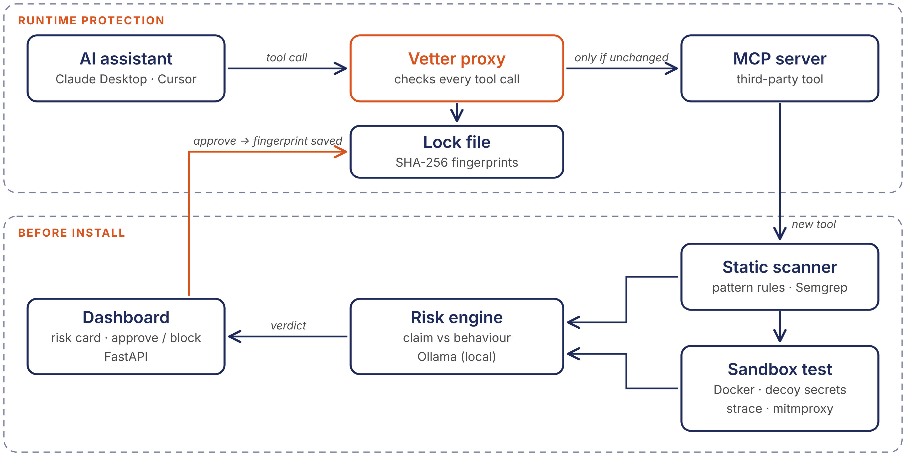

# vetter-mcp
App-store review for the AI tools you connect to your assistant: scans MCP servers, sandbox-tests them with decoy secrets, and pauses any tool that changes after approval.

## The problem

MCP servers run with your AI assistant's full trust: whatever they tell the model to do, the model will try to do. A tool can describe itself as "gets the weather" and quietly also read your SSH keys, or it can change its own description *after* you've already approved it — a classic "rug pull." Most people have no way to see that happening, and no way to stop a tool mid-change before the model acts on it.

vetter is a review layer that sits between you and your MCP servers: it inspects what a server *says* it does, actually runs it in a sandbox to see what it *does* do, and — through its runtime proxy — pauses any tool whose definition drifts from what you last approved.

## How it works



1. **Static scan** — reads every tool's name, description and input schema (and source code, when available) looking for hidden instructions, invisible Unicode, sensitive file paths, leaky input fields, and a declared-purpose-vs-capability mismatch.
2. **Sandbox run** (Python servers today) — launches the server with a fake `$HOME` seeded with uniquely-tagged decoy secrets, an audit hook watching file/network/subprocess activity, and a local logging HTTP(S) proxy that never reaches the real internet. Every tool is called once with harmless sample arguments; if a decoy secret shows up on the wire, that's a canary leak.
3. **Fingerprinting** — approving a server snapshots the `{name, description, input_schema}` of every tool it advertises (SHA-256 + the full snapshot) into `vetter-lock.json`.
4. **Runtime proxy** — `vetter proxy` sits between your assistant and the real server, re-checks the fingerprint on every `tools/list` and `list_changed` notification, and blocks `tools/call` for anything that changed since approval, logging an incident instead of silently letting it through.

## Quick start

```bash
git clone https://github.com/prithvipm412/vetter-mcp.git && cd vetter-mcp
./start.sh          # installs deps, starts the backend on :8000 and the dashboard on :5173
```

Or drive it from the CLI instead of the dashboard:

```bash
python3 -m venv .venv && source .venv/bin/activate
pip install -e ".[dev]"
vetter demo         # fresh reset, runs all 3 demo scenarios end to end, prints a summary table
vetter scan weather_ok
vetter approve weather_ok
vetter proxy --server weather_ok -- python -m demo_servers.weather_ok
```

Copy `.env.example` to `.env` to override the DB path, lock file path, CORS origins, or backend port.

## CLI reference

| Command | What it does |
|---|---|
| `vetter scan [ids...] [--no-sandbox]` | Static-scan (and sandbox, unless skipped) one or more servers; defaults to every known server. |
| `vetter sandbox <id>` | Run only the lite sandbox for one server and print what it touched. |
| `vetter approve <id>` | Fingerprint and approve a server's current tools. |
| `vetter verify <id>` | Compare a server's live tools against its approved baseline. |
| `vetter proxy --server <id> -- <command...>` | Run the runtime protection proxy in front of a real server command. |
| `vetter protect [--undo]` | Wrap every server in the Claude Desktop config to go through the proxy (or restore the last backup). |
| `vetter serve [--host] [--port] [--reload]` | Run the FastAPI backend. |
| `vetter demo` | Fresh reset, run all 3 demo scenarios (honest / malicious / rug pull) end to end, print a summary table. |

## API reference

See [API.md](API.md) for the full backend ↔ frontend contract, including `/api/import` for pulling in real MCP servers from an assistant's own config.

## vetter vs. MCP-Scan

[MCP-Scan](https://github.com/invariantlabs-ai/mcp-scan) is a static scanner for MCP tool definitions — it's fast, requires nothing running, and is a good first pass. vetter does that same static pass, then goes further: it actually *runs* each tool in an isolated sandbox with decoy secrets to catch behavior a description alone can't show (a tool that reads `~/.ssh` or phones home, regardless of what it says it does), and its runtime proxy keeps watching after approval, so a tool that changes its description post-approval gets paused instead of silently trusted. The trade-off is cost: the sandbox run is slower than a pure static scan, and today it only covers Python servers.

## Limitations

vetter reduces risk and gives you evidence — it can't prove a tool is safe. A sandboxed run exercises each tool once with sample arguments; a server that behaves differently under real arguments, or that only misbehaves on some inputs, won't be caught. Static analysis can miss obfuscated or dynamically-generated malicious code. The sandbox audits file/network/subprocess activity but isn't a hard security boundary (it doesn't use OS-level isolation like containers or VMs). Non-Python servers today only get the static scan.

## Roadmap

- Docker-based sandbox so any language gets the same dynamic analysis Python does today
- Community reputation/signing for commonly-used MCP servers
- Approval expiry, so a stale approval doesn't stay trusted forever

## Screenshots

_(placeholder — add dashboard screenshots here)_

## License

MIT — see [LICENSE](LICENSE).
